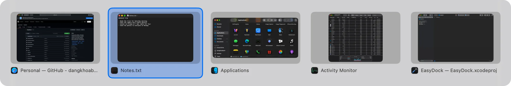
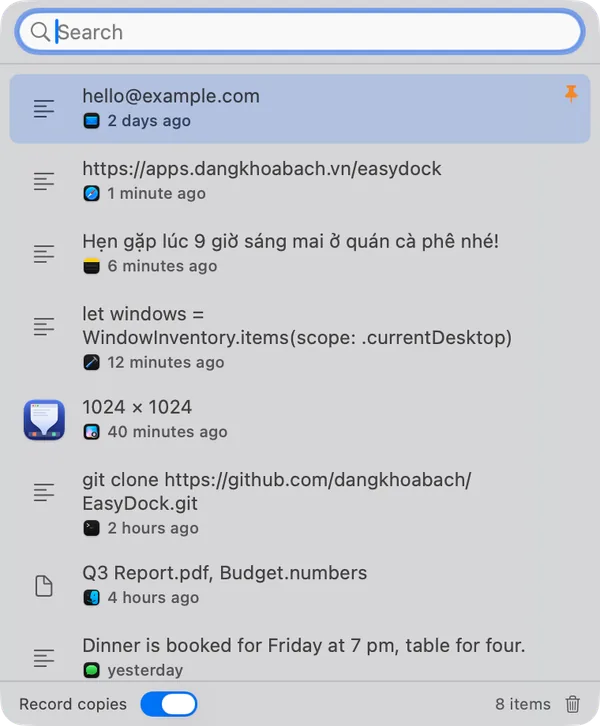
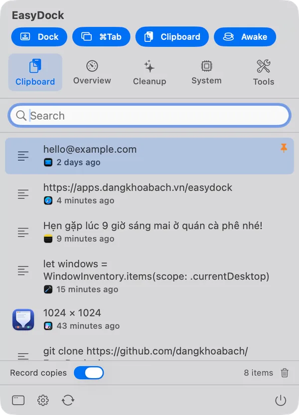
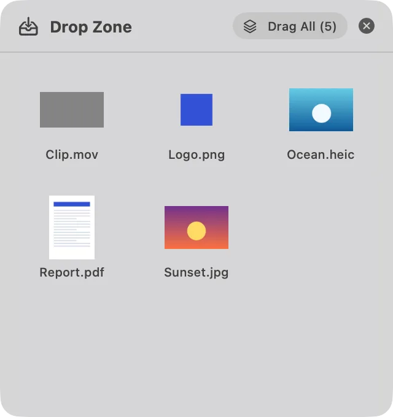
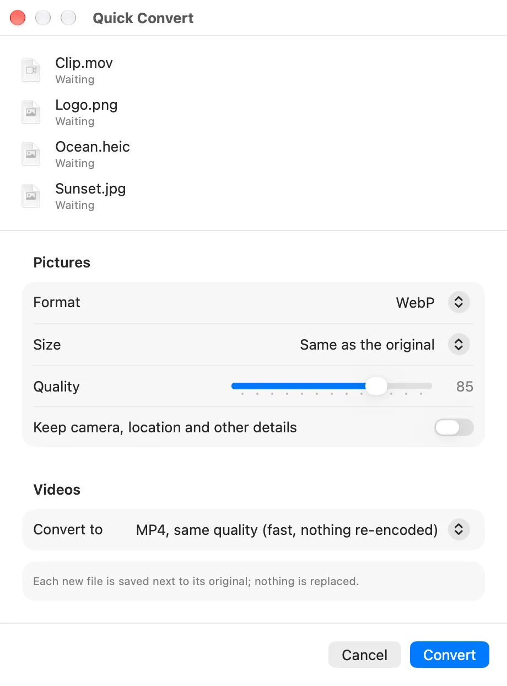
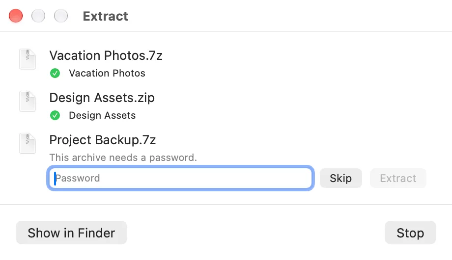
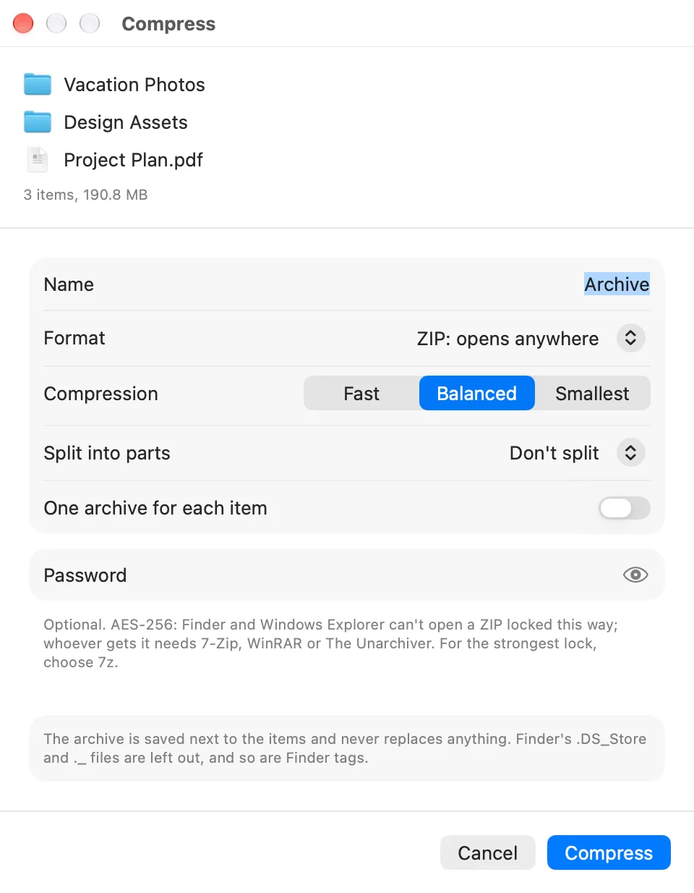
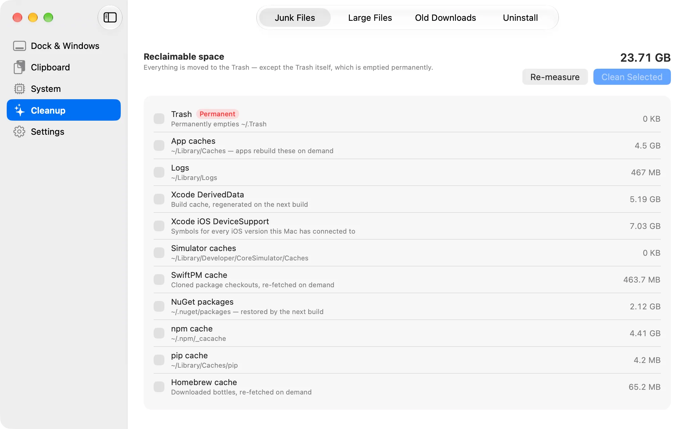

# EasyDock

Everyday Mac utilities, made easy. A native macOS app (Swift, SwiftUI) that brings a few habits
people miss from Windows to the Mac, and keeps a handful of system tools in one place, most of
them a click away in the menu bar.

<picture><source media="(prefers-color-scheme: dark)" srcset="docs/screenshots/switcher-dark.webp"></picture>

## What it does

- **Click a Dock icon to minimize.** Clicking the icon of the app you are using minimizes its
  windows and brings forward the app you used before it; the next click brings them all back,
  like the Windows taskbar. Hiding the app instead is an option, and some apps can keep the
  usual click. macOS doesn't let other apps minimize windows while Stage Manager is on, so the
  feature stands aside then and says why.
- **A window switcher on ⌘Tab.** Every window with a picture and its title, most recently used
  first, including minimized windows and windows on other Spaces. A quick ⌘Tab goes back to the
  previous window; hold ⌘ to see the list, Tab and the arrows to move, Esc to cancel. It can list
  every desktop's windows, or only the current desktop's: the one on each display, with full-screen
  apps and apps with no window open listed from every desktop. ⌥Tab can be chosen instead, which
  leaves the system's ⌘Tab alone.
- **Clipboard history.** Text, rich text, images and files, searchable, with pinned items,
  stored encrypted on your Mac. Open it from the menu bar or with ⌘⇧V near the pointer; Return
  pastes, ⌥Return pastes plain text. Copies that password managers mark as concealed are never
  recorded, and neither is anything copied in the apps you exclude (password managers by
  default). Works on macOS 14 and later.
- **System.** CPU with its performance and efficiency cores, GPU, memory, disks, battery and
  its health, temperatures, network, the last hour or day of CPU, memory and temperature, and
  every app and process with Quit and Force Quit. Alerts when the Mac runs hot or the battery
  runs low, and when memory runs short, naming the heaviest apps you aren't using. Apps you
  choose can be quit once they go unused for a while, the normal way: unsaved work asks first.
- **Cleanup.** Caches and build leftovers, a large files scan, old items in Downloads, and an
  uninstaller that lists every app with its size and when it was last opened, removes several
  at once with what they left in your Library, notices an app you move to the Trash, and finds
  what apps removed long ago left behind. The launch agents and daemons apps
  installed, with their app, whether they run and their memory; your own can be switched off.
  Everything is previewed first and goes to the Trash. Unavailable simulators and Homebrew's old
  versions are cleaned by their own tools, when those are installed. Caches can be cleaned on a
  schedule.
- **Always on Top.** ⌃⌥T keeps the window you are using above the others, as PowerToys does
  on Windows. macOS doesn't let an app put another app's window above the one in use, so
  EasyDock shows a live copy of the pinned window above the others while you work elsewhere;
  click the copy to use the window. Up to three windows, each staying on its own desktop.
- **Color Picker.** ⌃⌥C opens the system's magnifier; the color under the pointer is converted
  to sRGB, so the value matches the web, and copied as HEX, RGB, HSL, SwiftUI or NSColor. Hold
  Shift to keep picking. The last 20 colors stay in the menu bar panel, with the ones you pin;
  named palettes copy as CSS variables, JSON, a SwiftUI extension or Tailwind 4, and a contrast
  check gives the WCAG ratio of a text color on a background.
- **Drop Zone.** A shelf above every window for files, pictures, links and text while you go to
  where they belong: shake a file as you drag it, drag it onto the notch, or press ⌃⌥Z. Drag the
  items out one by one or all at once.
- **Quick Convert.** From Finder's right-click menu or the Drop Zone: pictures to WebP, AVIF,
  HEIC, JPEG or PNG at a size you choose, with or without their camera and location details;
  videos to MP4, H.264 or HEVC, or their sound to M4A. Every result is a new file next to the
  original.
- **Extract.** RAR, 7z and the other archives macOS can't open, from a double-click, Finder's
  right-click menu or the Drop Zone: RAR and 7z with or without a password, whole or split into
  parts, and ZIP, TAR, GZ, BZ2, XZ, ZST, CAB, ISO, ARJ and LZH. The contents go next to the
  archive and nothing is replaced; a password is asked for only when one is needed and is never
  kept. Names in ZIPs made by older Windows tools come out in their own language. 7-Zip does the
  unpacking, in a sandbox that can only read the archive and write next to it, and everything
  that comes out keeps the archive's quarantine, so Gatekeeper still checks a downloaded app.
- **Compress.** Files and folders into ZIP, 7z, TAR.GZ, TAR.XZ, TAR.BZ2 or TAR, from Finder's
  right-click menu or the Drop Zone: fast, balanced or smallest, with a password (AES-256; a 7z
  hides its file names too), split into parts for mail or a FAT32 disk, and one archive for each
  item if you like. Unlike Finder's Compress, a ZIP's names read right on Windows, accents
  included, and Finder's `.DS_Store`, `._` files and `__MACOSX` folder are left out. The archive
  goes next to the items and nothing is replaced. 7-Zip does the work, in a sandbox that can only
  read what you chose; links are kept as links, never followed.
- **Keep Awake.** Keeps the Mac and its display awake until you turn it off or for 15 minutes to
  4 hours, or while apps you choose are open; the display can be left to sleep. It stops on
  battery at a level you choose, and the menu bar icon shows a cup while it is on. ⌃⌥A turns
  it on and off. A session carries on when EasyDock starts again on its own, as after an update.
- **Menu bar panel.** Switches for each feature, the clipboard history, the Mac's vitals and
  the busiest apps, cleanup, the process list and the tools, opened from the menu bar or with
  ⌃⌥D. The icon can show the CPU.
- English and Vietnamese, light and dark appearance. Opened at login, it stays in the menu bar.

<table>
  <tr>
    <td width="50%"><picture><source media="(prefers-color-scheme: dark)" srcset="docs/screenshots/history-dark.webp"></picture></td>
    <td width="50%"><picture><source media="(prefers-color-scheme: dark)" srcset="docs/screenshots/menubar-dark.webp"></picture></td>
  </tr>
  <tr>
    <td width="50%"><picture><source media="(prefers-color-scheme: dark)" srcset="docs/screenshots/dropzone-dark.webp"></picture></td>
    <td width="50%"><picture><source media="(prefers-color-scheme: dark)" srcset="docs/screenshots/convert-dark.webp"></picture></td>
  </tr>
  <tr>
    <td width="50%" valign="top"><picture><source media="(prefers-color-scheme: dark)" srcset="docs/screenshots/extract-dark.webp"></picture></td>
    <td width="50%" valign="top"><picture><source media="(prefers-color-scheme: dark)" srcset="docs/screenshots/compress-dark.webp"></picture></td>
  </tr>
</table>

<picture><source media="(prefers-color-scheme: dark)" srcset="docs/screenshots/cleanup-dark.webp"></picture>

## Requirements

macOS 14 Sonoma or later, Apple silicon or Intel.

| Permission | Used for | Without it |
| :--- | :--- | :--- |
| Accessibility | Dock clicks, the window switcher, pasting from the clipboard history, pinning a window | Those stay off; the rest works |
| Screen Recording | Pictures of windows in the switcher, the copy of a pinned window | The switcher shows app icons instead, and windows can't be pinned |
| Notifications | System alerts, the scheduled cleanup's report, an app removed with files left, memory running short | Asked when you turn one of them on, or the first time one of the last two happens |

EasyDock is not sandboxed: reading other apps' windows, the Dock and the system's ⌘Tab setting
is not possible from the sandbox.

## Install

Download the latest version from
[apps.dangkhoabach.vn/easydock](https://apps.dangkhoabach.vn/easydock) or from
[Releases](https://github.com/dangkhoabach/EasyDock/releases), and drag EasyDock to Applications.

- The app is signed with an Apple Development certificate, not a Developer ID, and is not
  notarized, so macOS blocks the first launch. Open it once from
  **System Settings → Privacy & Security → Open Anyway**.
- On first launch, allow **Accessibility** and **Screen Recording** when asked; the table above
  says what each is for. Both carry over to every update.
- Updates arrive through **Check for Updates…** (in the menu bar panel, or right-click the
  menu bar icon), signed with the release key.
  Quitting EasyDock gives ⌘Tab back to macOS.

## Privacy

- No account, no telemetry, no analytics. The only network request is the update check
  (Sparkle) to `updates.dangkhoabach.vn`, which can be turned off in Settings.
- The clipboard history never leaves your Mac. Every item is sealed with AES-GCM under a key
  kept in your login Keychain, so the database holds no copied text in clear, and deleted items
  are overwritten. Clearing the history deletes the key too, so an old backup of the database
  can't be read.
- Logs (`log stream --predicate 'subsystem == "com.dangkhoabach.easydock"'`) carry app
  identifiers and counts, never what was copied.

## Undocumented macOS calls

Some features have no public API. Every such call is in one file,
[`PrivateAPIs.swift`](EasyDockApp/Platform/PrivateAPIs.swift), looked up by name when the app
runs: if a future macOS removes one, the feature that needs it turns itself off instead of
crashing.

| Call | Why |
| :--- | :--- |
| `CGSSetSymbolicHotKeyEnabled`, `CGSIsSymbolicHotKeyEnabled` | Turn the system's ⌘Tab off while the switcher replaces it, and back on |
| `SLSMainConnectionID`, `SLSCopySpacesForWindows`, `SLSGetActiveSpace` | Tell real windows apart and find the ones on other Spaces |
| `SLSCopyManagedDisplaySpaces` | Which desktop each display shows, and which Spaces are full-screen apps, for the current desktop option |
| `_AXUIElementGetWindow`, `_AXUIElementCreateWithRemoteToken` | Match an Accessibility window to a window number, and reach windows on other Spaces |
| `GetProcessForPID`, `_SLPSSetFrontProcessWithOptions`, `SLPSPostEventRecordTo` | Bring one particular window forward, not just its app |
| `responsibility_get_pid_responsible_for_pid` | Count an app's helper processes with it when memory runs short |

The system's ⌘Tab setting is shared by the whole system and outlives the app, so EasyDock turns
it back on when it quits, and a small watcher (the same executable, run a second time) does so
even if the app is killed. While a password field has secure input on, ⌘Tab is handed back to
the system.

## Limitations

- With Stage Manager on, the Dock click does nothing extra, and the switcher shows each window
  as it looked the last time its app was in front. A pinned window's copy shows it as it was
  when you left it: macOS stops drawing the windows in the strip.
- With the lid closed on battery and no external display, the Mac sleeps even with Keep Awake
  on; stopping that takes administrator rights.
- ⌘⇧V is also "paste and match style" in some apps; change the shortcut in Settings if you
  use that.
- A password copied by a browser extension counts as copied in the browser, unless the
  extension marks it as concealed, as most password managers do.
- Text over 1 MB and images over 40 megapixels are not kept in the clipboard history.
- The process list counts each app's main process; helpers such as browser tabs are listed
  under All Processes.
- Background Items switches off only your own launch agents: one an app registered turns itself
  back on when the app opens, and one for every user needs an administrator, so those are
  switched in System Settings › Login Items.
- Quick Convert writes what macOS and libwebp can: no WebM, MKV or AVI.
- Extract doesn't read LZ4. A link inside an archive that leads outside it is left out.
- Compress makes no RAR (only RARLAB's own software may) and no ZST (7-Zip only reads it).
  Finder tags and other Mac-only details aren't kept. A ZIP password is letters without accents,
  digits and symbols, as 7-Zip writes ZIPs; a 7z takes any. Finder and Windows Explorer can't
  open a ZIP with an AES-256 password: whoever gets one needs 7-Zip, WinRAR or The Unarchiver.
  Names in a TAR are kept as macOS wrote them.
- 7z files stay with Archive Utility, macOS's own app for them, and archives you set to another
  app in Finder's Get Info stay with it; one click in Tools › Extract opens them with EasyDock.
  Finder can keep showing the previous app's icon on archives it showed before, until macOS's
  icon cache is cleared.

## How it works

- **`EasyDockCore`** (Swift package: Foundation, CryptoKit and GRDB): settings, the clipboard
  store and its encryption, the Dock click decision, the switcher's order, the scheduler,
  system history and cleanup rules, Keep Awake's rules, color formats and palettes, the rules of
  Always on Top, the Drop Zone's shake and shelf, Quick Convert's names and the WebP encoder,
  reading launch agents, the memory rules, what Extract works out: an archive's format from
  its first bytes, its parts, where its contents go, 7-Zip's output and ZIP names written in a
  Windows code page, and what Compress asks 7-Zip for: its arguments for each format and level,
  the archive's name and parts, and the names made NFC. It is tested headless.
- **`EasyDockApp`** (SwiftUI and AppKit): the menu bar panel, the main window, event taps,
  Accessibility, ScreenCaptureKit, power assertions and the system readers.
- GRDB, Sparkle and libwebp (through SDWebImage's `libwebp-Xcode` package, for writing WebP)
  are pinned in `Package.resolved`. 7-Zip 26.06 is built from its unmodified source in
  [`ThirdParty/7-Zip`](ThirdParty/7-Zip/README.md) and runs as a separate program,
  `Contents/Helpers/7zz`. Their licenses are in Settings › Third-Party Software and in
  [`ThirdPartyNotices.txt`](EasyDockApp/Resources/ThirdPartyNotices.txt).

## Build from source

Requirements: Xcode 26 or later.

```zsh
cp Local.xcconfig.example Local.xcconfig   # then pick a signing identity in it
open EasyDock.xcodeproj
```

`Local.xcconfig` (gitignored) is the project's base configuration, so the build fails until it
exists rather than silently picking an identity. The example explains the three choices:
ad-hoc signing builds but makes macOS ask for the permissions again after every build,
`./scripts/create-signing-cert.sh` makes a self-signed identity that keeps them, and an Apple
Development certificate also keeps the Keychain from asking for the clipboard key again.

Tests:

```zsh
cd EasyDockCore && swift test   # 225 tests
xcodebuild test -project EasyDock.xcodeproj -scheme EasyDockApp -destination 'platform=macOS'   # 66 tests
```

The first build also compiles 7-Zip, in about ten seconds for each architecture.

The app icon is drawn by code: `swift scripts/generate-app-icon.swift`. Releases are built,
verified and packaged locally: see [docs/release.md](docs/release.md).

## Forking

Change these before you ship your own build, so it doesn't share data or updates with the
official app:

- `PRODUCT_BUNDLE_IDENTIFIER` in the Xcode project.
- `SUFeedURL` and `SUPublicEDKey` in `EasyDockApp/Info.plist`, with your own Sparkle key.
- The Keychain service in `EasyDockApp/Clipboard/ClipboardKeyStore.swift`.

## Security

Please report vulnerabilities privately, as described in [SECURITY.md](SECURITY.md).

## Contributing

Issues are welcome. This is a personal project, so pull requests are read but may not be
merged.

## License

[MIT](LICENSE) for the source code. The EasyDock name and app icon are not covered by the
license; use your own for a fork.
